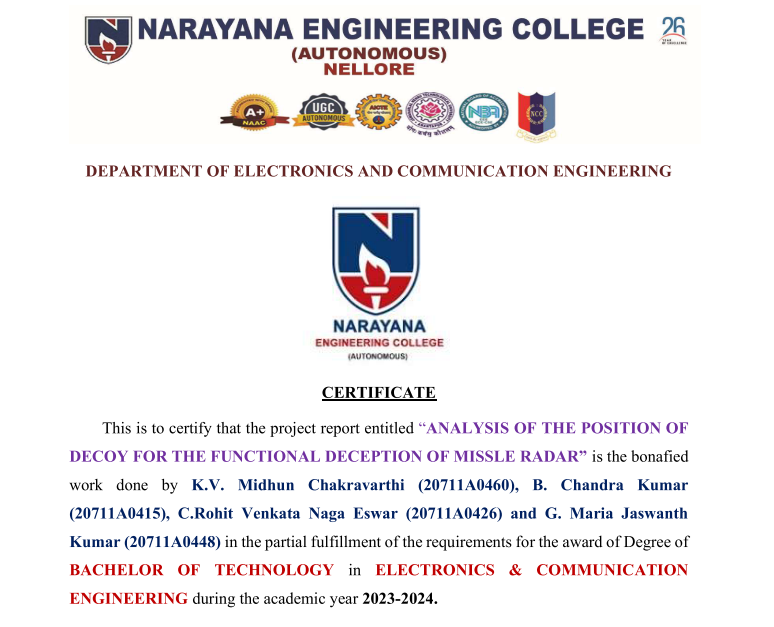
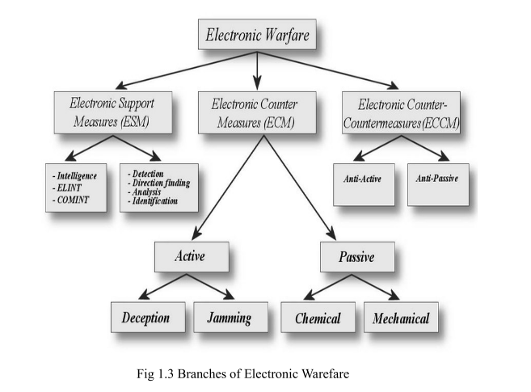
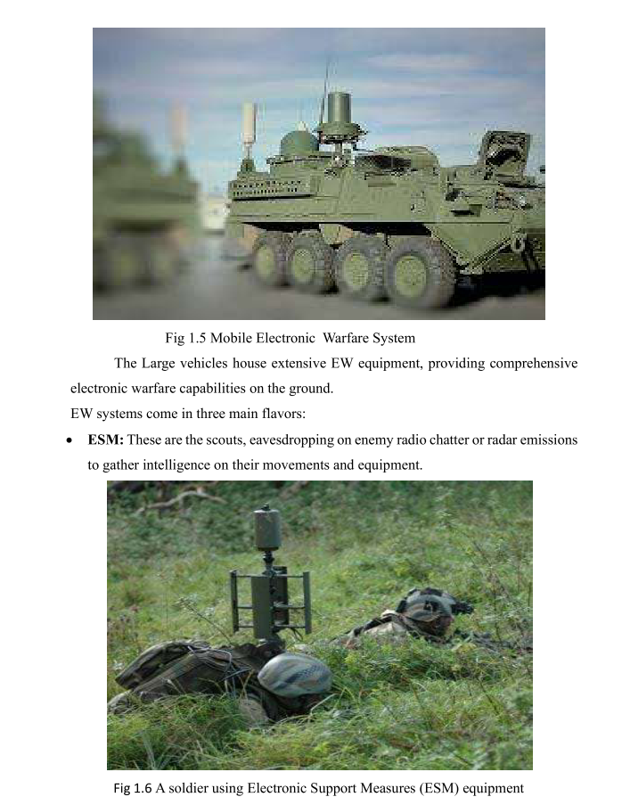
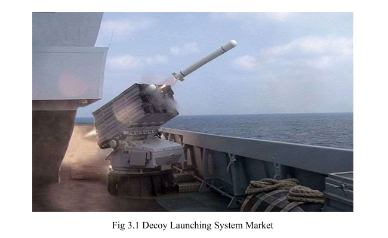
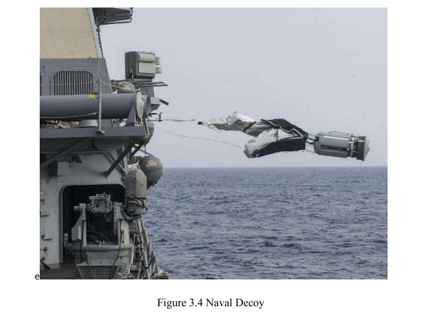
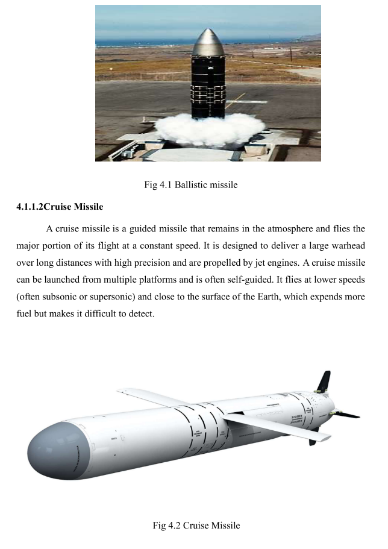
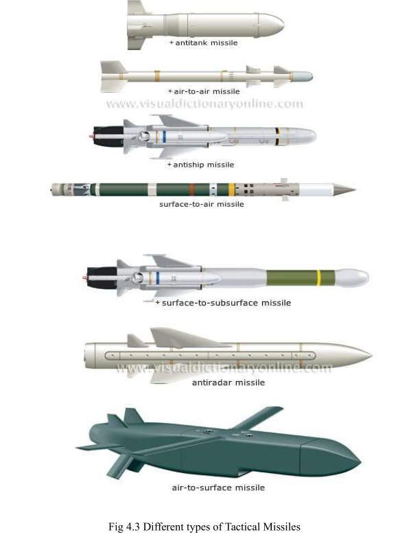
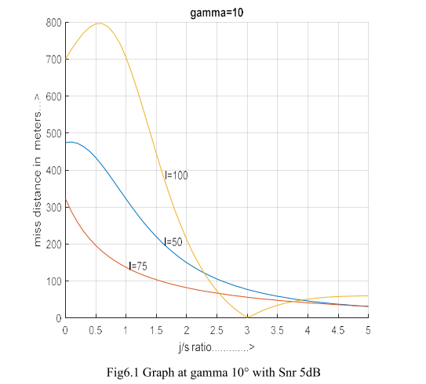
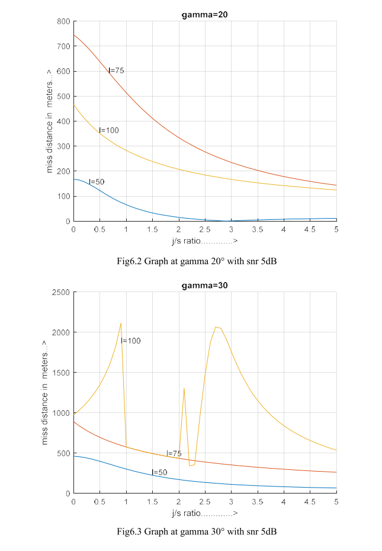

# Analysis of the Position of Decoys for Functional Deception in Missile Radar [with MATLAB Code + Paper]

1. Introduction
Chapter 2 Literature Review 16-17
Chapter 3: Decoy Launcher System Market 18-22 3.2 Seahawk Anti-ship Missile 19 3.3 Mald Decoy 20 3.4 Navy Decoy 21 3.5 Sea Unveils Trainable Decoy Launcher 22
Chapter 4 Missile Classifications 23-31 4.1 Missile Types 24 4.1.1 Strategic Missiles 24 4.1.1.1 Ballistic Missiles 24 4.1.1.2 Cruise Missiles 25 4.1.2 Tactical Missiles 26 4.2 Missile Guidance Systems 29 4.2.1 Inertial Guidance 29 4.2.2 Global Positioning System (GPS) 29 4.2.3 Radar Guidance 30 4.2.4 Infrared Guidance 30 4.2.5 Single Pulse Radar Guidance 31
Chapter 5 Active Decoy Deployment 32-35 5.1 Problem Definition 32 5.2 Decoy Deployment Geometrical Considerations 32 5.3 Mathematical Formulas 35
Chapter 6 Results and discussions 36-48 6.1 Noise (SNR 5dB) 36 6.2 Noiseless (SNR 0 dB) 43
Chapter 7 Source Code 49-54 7.1 Code 48 Chapter 8 Conclusion and Future Scope 55-57 8.1 Conclusion 55 8.2 Future Scope 55 References 58-60
Article illustrations

## Images

<!-- PAYMENT_BLOCK -->

## Get this dataset

- Payment link (Stripe): [Buy now](https://buy.stripe.com/3cs8yP7sY87d0vu9AB)
- Payment QR code: 

<!-- /PAYMENT_BLOCK -->
